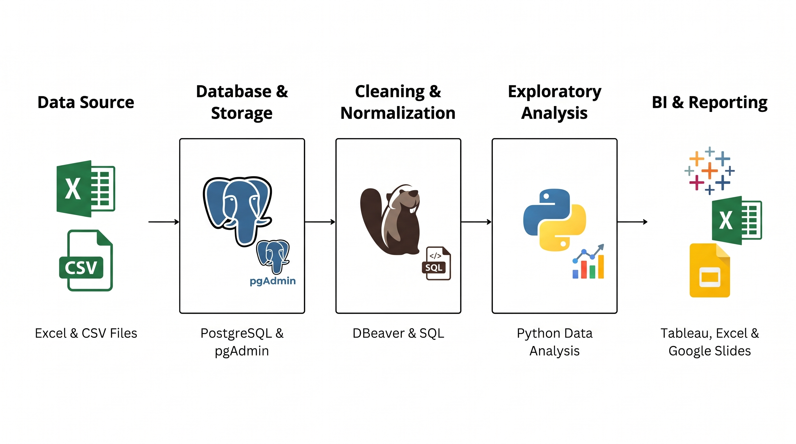
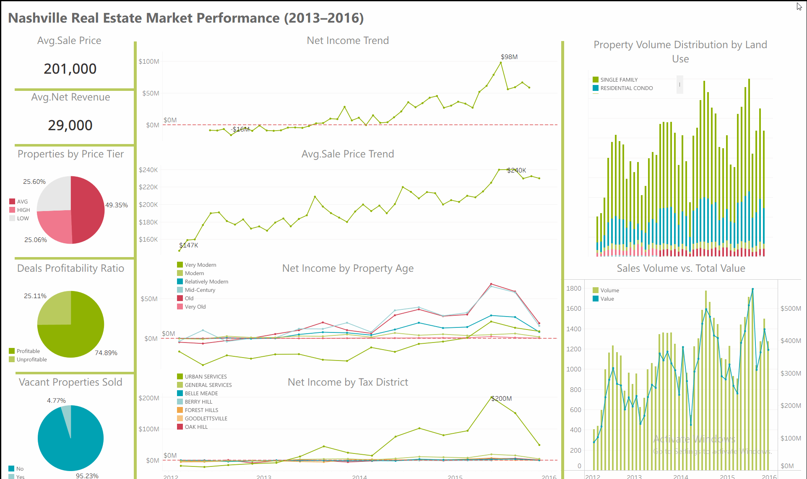

# Nashville Real Estate Data Engineering and Market Analysis (2013 to 2016)

## 📚 Table of Contents
* [Project Summary](#-Project-Summary)
* [Database Configuration and Data Loading](#️-Database-Configuration-and-Data-Loading)
* [Data Cleaning, Transformation, and Normalization](#-data-setup--architecture)
* [Exploratory Data Analysis, Feature Engineering, and Business Insights](#-data-accuracy--logical-validation)
* [Data Visualization, Interactive Dashboarding, and Executive Presentation](#-data-exploration--key-queries)
* [Repository Structure and Detailed Documentation](#-advanced-sql-techniques)

##  Project Architecture

##  Project Summary
data analysis, exploratory analysis, and business intelligence project on over 56000 housing transactions in Nashville. Raw spreadsheet records were migrated into PostgreSQL, cleaned and normalized into a relational schema using SQL, analyzed with Python to solve key financial questions, and delivered through an interactive Tableau dashboard and executive presentation.

##  Database Configuration and Data Loading
What Was Done: Converted the raw Excel dataset to CSV, built the NashvilleHousingData database in PostgreSQL 18 via pgAdmin 4, defined a 19 column staging table, and connected DBeaver for SQL operations.

Final Outcome: Successfully ingested over 56000 raw records and automatically standardized sale dates into clean date formats upon import.

##  Stage 2: Data Cleaning, Transformation, and Normalization
What Was Done: Populated missing property addresses via self joins, split composite property and owner addresses into atomic street, city, and state columns, standardized SoldAsVacant flags, cleaned ParcelID strings with regular expressions, converted land area from acres to square meters, removed initial duplicates, and decomposed the flat table into a normalized 3 table relational schema before dropping the staging table.

Final Outcome: Transformed a single unorganized 33MB flat table into a clean, lightweight relational database consisting of ownerinfo, propertyinfo, and saleinfo linked by primary and foreign keys.

##  Stage 3: Exploratory Data Analysis, Feature Engineering, and Business Insights
What Was Done: Purged 4000 redundant sales transactions, engineered new analytical features (price tiers, net income margins, profitability status, and 6 architectural age eras), built SQL reporting views, and analyzed market trends using Python.

Final Outcome and Core Discoveries:

Why 2013 and 2014 Had Negative Returns: Severe losses from vacant land sales (losing 54.5 million dollars in 2014 alone) and newly constructed post 2009 properties (losing nearly 98 million dollars in 2013 and 96 million dollars in 2014).

Population Growth Ruled Out: Official city statistics showed only a 6.5 percent population growth over 5 years, proving demographic growth was not the main driver of the profit boom.

What Drove the 2015 and 2016 Profit Boom: Lower assessed baseline costs in 2016 combined with surging demand for developed Single Family homes (which generated 487.5 million dollars in net revenue in 2016), confirming that families are the primary buyer persona.

Best Time and Location to Close Deals: Mid year summer months (May to July) recorded the highest deal prices (240000 dollars) and peak monthly profit (nearly 100 million dollars in June 2016), while the Urban Services District generated 492 million dollars in 2016 through high transaction volume.

Operational Deliverable: Exported a targeted Excel list of the top 16 repeat VIP buyers (owning 10 or more properties) for Public Relations and Sales outreach.

##  Stage 4: Data Visualization, Interactive Dashboarding, and Executive Presentation
What Was Done: Connected Tableau Desktop directly to PostgreSQL in Extract mode, linked the 3 relational tables, built 11 specialized worksheets, assembled a 3 column executive dashboard, and recorded a full strategic presentation in Google Slides.

Final Outcome: Delivered a production ready Tableau Dashboard summarizing key metrics (201000 dollar median sale price, 29000 dollar median net revenue, and 74.89 percent profitable deals ratio) alongside an Executive Market Analysis Presentation prepared by Wesam Musalli.

##  Repository Structure and Detailed Documentation
- Stage 1: Environment Setup and Data Ingestion
- Stage 2: Data Cleaning and Database Normalization
- Stage 3: Exploratory Data Analysis and Business Insights
- Stage 4: Tableau Dashboard and Executive Presentation
